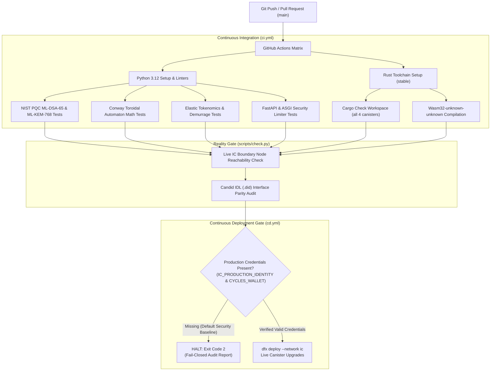
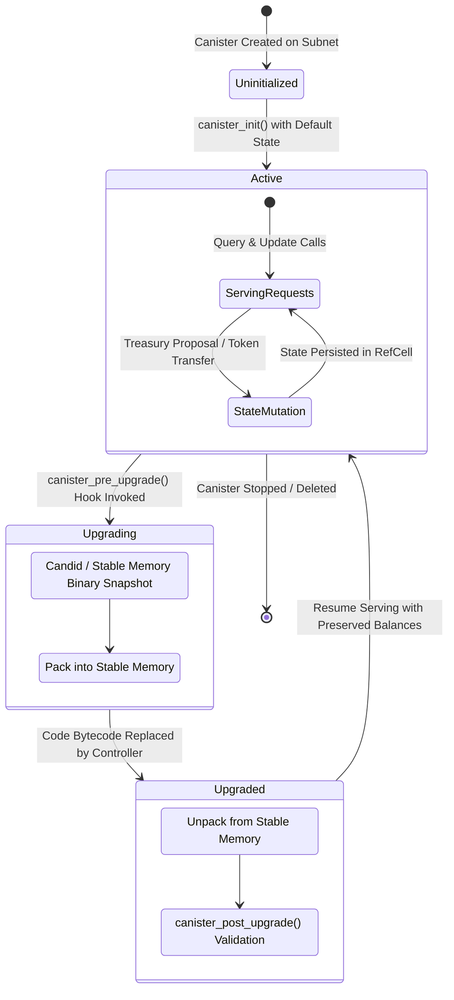
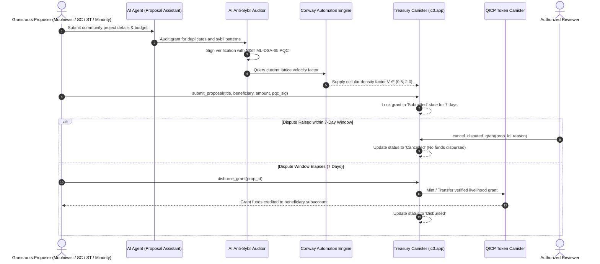
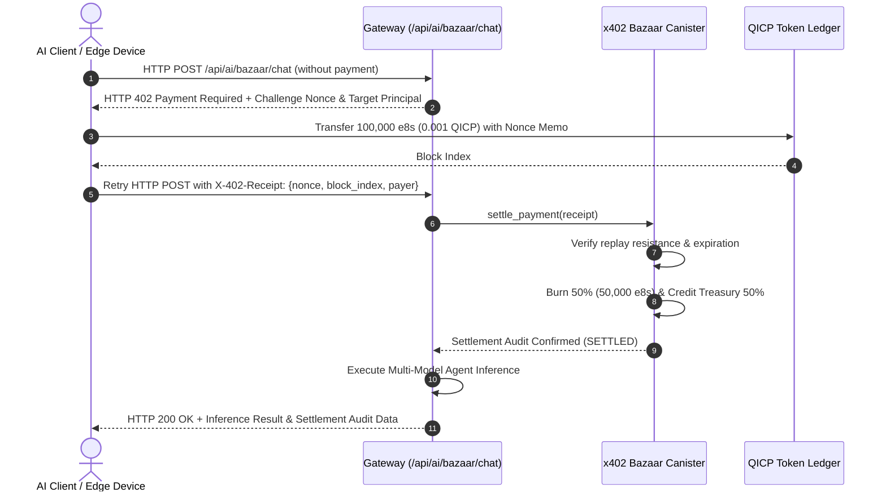
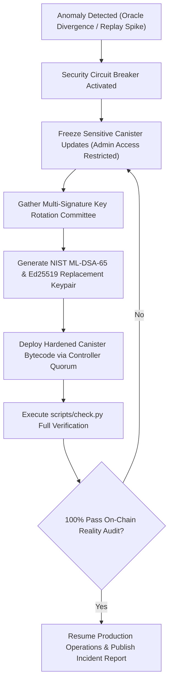

# QICP Equality: Engineering Workflow Design & Lifecycle Architecture

## Document Purpose & Scope

This specification formalizes the engineering workflows, automated continuous integration and continuous deployment (CI/CD) pipelines, canister upgrade lifecycles, governance dispute timelocks, and payment settlement flows governing the **QICP Equality** protocol.

All workflows follow a **strict fail-closed, zero-simulation** engineering standard.

---

## 1. Automated CI / CD Pipeline Architecture

The Continuous Integration and Deployment pipeline enforces cryptographic validation, deterministic mathematical models, canister Wasm builds, and fail-closed mainnet release controls.

---

## 2. Canister State Machine & Upgrade Lifecycle

Canisters on the Internet Computer maintain persistent memory across code upgrades. QICP canisters utilize deterministic state transitions and pre/post-upgrade serialization hooks.

---

## 3. Grassroots Grant Proposal & Conway Timelock Flow

The grant allocation pipeline combines multi-model AI proposal drafting, anti-sybil auditing, deterministic Conway automaton velocity weighting, and a mandatory 7-day dispute window before disbursement.

---

## 4. RFC HTTP 402 Pay-Per-Inference Settlement Loop

The x402 bazaar canister provides micro-payment monetization for AI model inference while enforcing Burn-and-Mint Equilibrium (BME).

---

## 5. Emergency Incident Response & Key Rotation Runbook

In the event of anomalous transactions, suspected private key compromise, or upstream infrastructure disruption, the protocol follows this emergency protocol:

---

## 6. Verification and Maintenance Checklist

1. **Rust Workspace**: Always run `cargo check --workspace` before submitting pull requests.
2. **Boundary Connectivity**: Maintain low-latency endpoints for `https://ic0.app` and `https://icp-api.io`.
3. **PQC Signatures**: Every governance action requires binding challenge commits with message digests.
4. **Zero-Mock Policy**: Tests and CI workflows must execute real algorithmic code paths.
